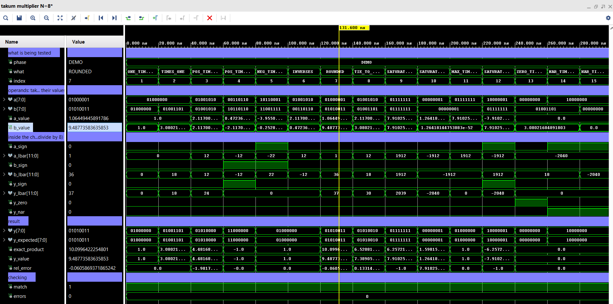

# takum-multiplier-vhdl

[](https://github.com/LeticiaVeran/takum-multiplier-vhdl/actions/workflows/tests.yml)

A multiplier for the logarithmic **takum** number format, written in
VHDL-2008 and wired to the official takum codec. It is verified exhaustively at
8 bits and by sampling up to 64 bits, with free tools (GHDL and Python), and
simulated and synthesised in Vivado for an Artix-7 FPGA (Nexys A7).

**Author:** [Leticia Veran](https://github.com/LeticiaVeran)

```
a ──▶ decoder ──▶ (S_a, lbar_a) ──┐
                                  ├──▶ takum_mul_log ──▶ (S_y, lbar_y) ──▶ encoder ──▶ y
b ──▶ decoder ──▶ (S_b, lbar_b) ──┘       (an adder)                     (rounds)
```



## Why the multiplier is just an adder

A logarithmic takum word encodes

    x = (-1)^S * sqrt(e)^l

so the product of two of them is

    x_a * x_b = (-1)^(S_a xor S_b) * sqrt(e)^(l_a + l_b)

Powers of the same base multiply by adding exponents, so there is no mantissa
multiplier anywhere in this design: one xor for the sign, one fixed-point adder
for the magnitude.

There is a twist. The codec does not expose `l` but the *barred* logarithmic
value `lbar = (-1)^S * l`, a choice that saves a two's complement negation in
both the decoder and the encoder. Undoing that on both operands and reapplying
it to the result leaves each term carrying the sign of the *other* operand:

    S_y    = S_a xor S_b
    lbar_y = (-1)^(S_b) * lbar_a + (-1)^(S_a) * lbar_b

clamped to [-255, 255), because takum saturates rather than overflowing to
infinity or collapsing to zero.

`lbar` is fixed point Q9.(N-5), so both operands carry the same number of
fractional bits and the sum is exact. Nothing is rounded here; all rounding
happens in the encoder.

## Repository layout

```
rtl/                     the hardware - the only place the design lives
├── takum_mul_log.vhd        the multiplier, on (S, lbar)
├── takum_mul_top.vhd        the chain: takum → decoder → multiplier → encoder → takum
└── codec/                   official decoder and encoder, with 5 documented patches
verification/            Python + GHDL test suite        → verification/README.md
├── run_tests.py             runs everything
├── takum_model.py           independent reference model
└── tb/                      file-driven testbenches
vivado/                  everything for Vivado           → vivado/README.md
├── create_project.tcl       builds a configured project
├── synth/                   measurement wrapper, constraints, batch flow, results
└── sim/                     N = 8 waveform testbench → vivado/sim/README.md
third_party/             the official codec, untouched, for reference and licence
docs/                    bibliography, technical documentation (Portuguese)
└── images/                  the pictures shown in these READMEs
.github/workflows/       runs the test suite on GitHub at every push
```

## Quick start

**Run the tests** (Ubuntu or WSL, needs `ghdl` and `python3`):

```
cd verification
python3 run_tests.py all
```

14 tests, about 25 seconds; the last line says how many passed. Step by step,
including how to open the terminal on Windows, in
[`verification/README.md`](verification/README.md).

**Open it in Vivado:** Tools → Run Tcl Script → `vivado/create_project.tcl`.
That creates a project with every file in place. Run Behavioral Simulation to
see the waveform; Run Synthesis for area and timing. The files, the steps by
hand, and the batch flow for measurements are in
[`vivado/README.md`](vivado/README.md).

## Verification

The reference model is independent of the hardware: it decodes every bit
pattern straight from the format definition, computes products with exact
fractions, and picks the nearest representable word, ties to even. It shares no
logic with the VHDL.

| Test | Inputs | Widths | Result |
|---|---|---|---|
| Multiplier alone | 20,492 vectors | 8, 12, 16, 24, 32, 64 | no mismatches |
| Full chain, every possible pair | 65,536 pairs | 8 | no mismatches |
| Full chain, exact reference | 3,002 pairs | 8, 12, 16 | no mismatches |
| Full chain, local rounding check | 3,002 pairs | 24, 32, 64 | no mismatches |
| Waveform testbench (own VHDL reference model) | 15 cases + 65,536 pairs | 8 | no errors |

The suite was also run against a deliberately broken multiplier, and every
test failed, as it should. How each check works is explained in
[`verification/README.md`](verification/README.md).

## The patched codec

The official codec targets Vivado, which accepts a few constructs that the VHDL
standard forbids and GHDL rejects; four patches rewrite them in standard
VHDL-2008. A fifth fixes an integer overflow in the encoder's rounding that
stopped the chain from simulating at 32 bits and above. Every patch is marked
in the source and explained in [`rtl/codec/README.md`](rtl/codec/README.md).
Both flows, simulation and synthesis, use the patched copy; the original is
kept in `third_party/`.

## Synthesis

Nexys A7 (`xc7a100tcsg324-1`, speed grade −1), Vivado 2025.1, out of context,
the same 10 ns clock constraint for every run, Fmax = 1000 / (10 − WNS):

| Variant | N | Slice LUTs | CARRY4 | DSP | Critical path | Fmax | Dynamic power |
|---|---|---|---|---|---|---|---|
| multiplier alone | 8 | 34 | 8 | 0 | 6.96 ns | 144 MHz | 1 mW |
| multiplier alone | 16 | 46 | 10 | 0 | 7.43 ns | 135 MHz | 2 mW |
| multiplier alone | 32 | 70 | 14 | 0 | 7.96 ns | 126 MHz | 3 mW |
| multiplier alone | 64 | 118 | 22 | 0 | 8.70 ns | 115 MHz | 5 mW |
| full chain | 8 | 168 | 8 | 0 | 12.03 ns | 83 MHz | 4 mW |
| full chain | 16 | 258 | 14 | 0 | 12.98 ns | 77 MHz | 6 mW |
| full chain | 32 | 433 | 22 | 0 | 13.95 ns | 72 MHz | 11 mW |
| full chain | 64 | 880 | 38 | 0 | 15.80 ns | 63 MHz | 22 mW |

- No DSP block at any width: the multiplier is an adder.
- The multiplier alone grows linearly and stays fast (8.7 ns at 64 bits). Most
  of the full unit is the codec: about 80 to 87 % of its LUTs.
- The full chain is one combinational path (decoder → adder → saturation →
  encoder → rounding), so its clock rate is set by the whole chain.

Details, critical paths and how the numbers were measured:
[`vivado/synth/results.md`](vivado/synth/results.md) and
[`vivado/README.md`](vivado/README.md).

## Automatic tests on GitHub

`.github/workflows/tests.yml` tells GitHub to run the whole test suite on its
own servers every time something is pushed. The badge at the top of this page
shows the result of the latest run: green means all 14 tests passed. Nothing
needs to be installed or configured for this; it starts with the first push.

## Status and next steps

The design is functionally verified and synthesised at 8, 16, 32 and 64 bits.
Next:

- comparison against posit multipliers of the same width, measured the same
  way;
- a division unit: the same hardware with the second logarithm subtracted, plus
  division by zero;
- addition and subtraction, which in a logarithmic number system need the Φ
  correction functions, the expensive part of the approach.

## Documentation

- [`docs/BIBLIOGRAPHY.md`](docs/BIBLIOGRAPHY.md) — annotated reading list: what
  each paper contributes and which part of this repository depends on it.
- [`docs/references.bib`](docs/references.bib) — the same entries as BibTeX.
- [`docs/Documentacao_Tecnica_VHDL_ABNT.docx`](docs/Documentacao_Tecnica_VHDL_ABNT.docx) —
  technical documentation in Portuguese (ABNT format): specification of the
  modules, verification, synthesis results and design decisions.

## Attribution

The decoder and the encoder come from
[Takum-Codec-RTL](https://github.com/takum-arithmetic/Takum-Codec-RTL) v1.1.0
by Laslo Hunhold (DOI [10.5281/zenodo.16923066](https://doi.org/10.5281/zenodo.16923066)),
used under the ISC licence; see [`third_party/`](third_party/README.md).

The format is described in L. Hunhold, *Beating Posits at Their Own Game: Takum
Arithmetic*, CoNGA 2024, and the codec in *Design and Implementation of a Takum
Arithmetic Hardware Codec in VHDL*, arXiv:2408.10594.

The multiplier, the testbenches, the reference model, the patches to the codec
and the build scripts are the work of Leticia Veran.

## Licence

ISC, matching the codec this integrates with. See [`LICENSE`](LICENSE).
