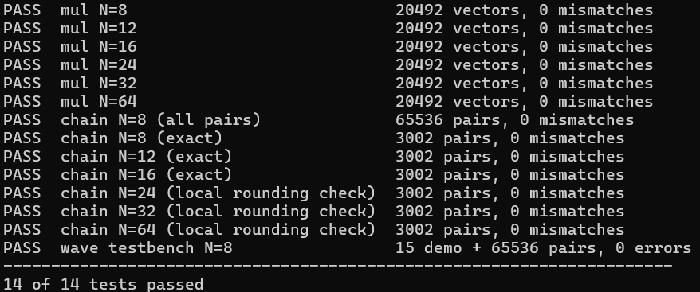

# verification — proving the multiplier right, with Python and GHDL

This folder answers one question: **for every input, does the hardware return
the correctly rounded takum product?** It does so with free tools only: GHDL
simulates the VHDL, and a Python reference model says what the right answer is.

## How to run it, step by step

The suite runs on Linux. On Windows it runs inside **WSL** (Ubuntu running
within Windows), which is how it was developed.

**1. Open a terminal in this folder.**
On Windows, open this `verification` folder in File Explorer, click the address
bar, replace its contents with `wsl` and press Enter: an Ubuntu terminal opens
already inside the folder. On Linux, open a terminal and `cd` into it.

If WSL is not installed yet, open PowerShell as administrator, run
`wsl --install`, restart the computer, and create the Ubuntu user it asks for.

If you prefer to start Ubuntu from the Start menu, go to the folder with `cd`;
Windows drives appear under `/mnt/`, so `C:\Users\me\takum-multiplier-vhdl`
becomes:

```
cd /mnt/c/Users/me/takum-multiplier-vhdl/verification
```

**2. Install the tools** (only the first time):

```
sudo apt update
sudo apt install -y ghdl python3
```

Check them with `ghdl --version` and `python3 --version`.

| Tool | Version | Why |
|---|---|---|
| GHDL | 4.x or newer | simulates the VHDL |
| Python | 3.8 or newer, no extra packages | reference model and test runner |
| GTKWave (optional) | any | to look at waveforms: `sudo apt install -y gtkwave` |

**3. Run everything:**

```
python3 run_tests.py all
```

It takes about 25 seconds (a bit longer when the folder is on the Windows
drive, which WSL reads more slowly). Every test prints one line, and the last
line says how many passed:



`14 of 14 tests passed` means the hardware gave the right answer for every
input tried. If anything fails, the first wrong results are printed above the
`FAIL` line; see [When something fails](#when-something-fails).

**4. Optional: look at a waveform.**
`python3 run_tests.py wave` runs the N = 8 testbench and saves its waveform;
open it with

```
gtkwave build/wave_n8.ghw
```

On Windows 11 the GTKWave window opens like any other program.

## What is in here

| File | Role |
|---|---|
| `run_tests.py` | runs everything: generates vectors, compiles, simulates, checks, summarises |
| `takum_model.py` | the reference model: decodes takums from the definition, multiplies with exact fractions, rounds |
| `tb/tb_takum_mul_log.vhd` | testbench for the multiplier alone, on the internal representation |
| `tb/tb_takum_mul_top.vhd` | testbench for the full chain, takum words in and out |
| `build/` | created on the first run: compiled units, vectors, results, waveforms (ignored by git) |

The hardware under test is in `../rtl/`; the waveform testbench, which is also
run here, is in `../vivado/sim/`.

## Commands

```
python3 run_tests.py all                  everything below, every width
python3 run_tests.py mul                  multiplier alone, N = 8, 12, 16, 24, 32, 64
python3 run_tests.py mul 16               ... only N = 16
python3 run_tests.py chain                full chain, N = 8, 12, 16, 24, 32, 64
python3 run_tests.py chain 8 --all-pairs  every one of the 65,536 pairs at N = 8
python3 run_tests.py wave                 the Vivado waveform testbench, under GHDL
python3 run_tests.py demo 16              nine readable vectors, printed as a table, plus a waveform
python3 run_tests.py clean                delete build/
```

## How it works

### The idea: two independent descriptions must agree

The VHDL and the Python model are two separate descriptions of the same
mathematics. The model is written to share nothing with the hardware: it
decodes each bit pattern straight from the definition of the format, computes
with exact fractions, and finds the nearest representable word by searching.
If both agree on thousands of inputs, including every edge case, an error would
have to be made identically in two very different programs.

### The format, as the model reads it

A takum word stands for `x = (-1)^S · √e^l`. Its fields (N = 16 shown):

```
S | D | R R R | C ... C | M ... M
1   1     3       r       p = N - r - 5
```

- `S` sign; `D` direction bit (1 when the characteristic is ≥ 0)
- `R` three regime bits, giving the characteristic length `r` (0 to 7)
- `C` the characteristic `c`, the integer part of the logarithm, in −255 … 254
- `M` the mantissa `m`, the fractional part, in [0, 1)

Words shorter than 12 bits behave as 12-bit words padded with zeros ("ghost
bits"). The codec does not output `l` itself but the **barred** logarithm
`lbar = (-1)^S · l = c + m`, as fixed point with 9 integer and N − 5 fractional
bits; this saves a negation in the decoder and in the encoder.

### The rule being tested

Powers of the same base multiply by adding exponents:

```
x_a · x_b = (-1)^(S_a xor S_b) · √e^(l_a + l_b)
```

so the hardware has no multiplier, only an adder. Because it works on `lbar`
rather than `l`, each term carries the sign of the *other* operand:

```
S_y    = S_a xor S_b
lbar_y = (-1)^S_b · lbar_a  +  (-1)^S_a · lbar_b      clamped to [-255, 255)
```

Both operands have the same number of fractional bits, so this sum is exact.
All rounding happens later, in the encoder.

### Rounding

The exact product is rounded to the representable word that is **nearest in
the logarithmic domain**, and on a tie, to the one whose bit pattern ends in 0.
Zero and NaR are never candidates, so a product too large stays at the largest
number (no infinity) and a product too small stays at the smallest (never
zero). Special cases: NaR times anything is NaR; zero times anything else is
zero.

### Three testbenches, three ways of checking

```
                  writes                       reads
takum_model.py ──────────▶ vec_mul_N.txt ─────────────▶ tb_takum_mul_log ──▶ "OK=… MISMATCHES=…"
  (vectors + expected results)                           (compares in VHDL)

takum_model.py ──────────▶ pairs_N.txt ───────────────▶ tb_takum_mul_top ──▶ out_N.txt
                                                         (only applies and records)    │
takum_model.py check ◀─────────────────────────────────────────────────────────────────┘
  (compares in Python)

tb_takum_mul_wave  (vivado/sim)   vectors and reference model inside the VHDL, N = 8
```

1. **Multiplier alone** (`mul`). 20,492 vectors per width on the internal
   representation `(S, lbar)`: every combination of 11 boundary values (the
   largest and smallest `lbar` and their neighbours, zero, ±1 ulp, ±1.0 and
   the halfway points) with both signs, 20,000 random pairs, and 8 zero/NaR
   combinations. Each line carries the expected result,
   and the testbench compares every field.
2. **Full chain** (`chain`). Takum words in, takum words out, through the
   official decoder and encoder. The testbench only applies the pairs and
   writes what came out; Python does the checking, because exact fractions are
   easy there and awkward in VHDL.
3. **Waveform testbench** (`wave`). Made for Vivado, see
   `../vivado/sim/README.md`. It has its own reference model inside, written
   from the definition and not from the hardware's crossed-sign rule.

### Exact check and local check

For N ≤ 16 the model enumerates all 2^N words, sorts them by value, and
computes the exact expected word for each pair (`check`). Beyond that,
enumerating is too slow, so it uses a **local check** (`check-local`): the word
the hardware produced must be closer to the exact product than both of its
neighbours, the words one step below and one step above, and on a tie it must
be the even one. Takum words are ordered like integers, so a word that beats
both neighbours is the nearest of all; this is exactly the definition of round
to nearest, ties to even, checked without listing every word.

### The model checks itself too

When it writes the multiplier vectors, the model computes each expected result
twice: once with the crossed-sign rule, and once by turning both operands into
floating-point numbers, multiplying them, and taking the logarithm again. The
second route does not use the rule, so a mistake in its derivation would make
the two disagree. They agree on every vector at every width.

### Can these tests fail?

A test suite that cannot fail proves nothing, so this one was checked against a
deliberately broken multiplier, with the signs not crossed
(`lbar_y = (-1)^S_a · lbar_a + (-1)^S_b · lbar_b`). Every test caught it. At
N = 8, the all-pairs chain check found 32,004 wrong results out of 65,536, and
the waveform testbench, with its own reference model written in VHDL, found
the same 32,004.

A crashed simulation cannot pass either. If GHDL stops early, the results file
is short, and every pair without an answer counts as a mismatch: an early
version of this suite reported `MISMATCHES=0` for a chain that had crashed
after its first vector, which is why this check exists.

## Coverage

| Test | Inputs | Widths | Result |
|---|---|---|---|
| Multiplier alone | 20,492 vectors | 8, 12, 16, 24, 32, 64 | no mismatches |
| Chain, all pairs | 65,536 pairs (every input) | 8 | no mismatches |
| Chain, exact reference | 3,002 pairs | 8, 12, 16 | no mismatches |
| Chain, local rounding check | 3,002 pairs | 24, 32, 64 | no mismatches |
| Waveform testbench | 15 named cases + 65,536 pairs | 8 | no errors |

## When something fails

A failing test prints its first mismatches before its result line. This is
what the broken multiplier above produced:

```
MISMATCH a=1010010111001101 b=0100110100111100 hw=1101110010000010 expected=1010001101111110
MISMATCH a=1100101000100110 b=0001100010111000 hw=1001011111111010 expected=1110100000000110
  ...
FAIL  chain N=16 (exact)                 3002 pairs, 1515 mismatches
```

`a` and `b` are the inputs, `hw` what the hardware produced. The files in
`build/` (`pairs_N.txt`, `exp_N.txt`, `out_N.txt`, with one line per pair, in
the same order) let you find the pair and rerun it alone. `takum_model.py` can
be used by hand as well; `python3 takum_model.py` lists its commands.

## Waveforms

`python3 run_tests.py wave` and `python3 run_tests.py demo 16` write `.ghw`
files into `build/`. Open them with `gtkwave build/wave_n8.ghw`.

GHDL 4.1 crashes ("GHDL Bug occurred") when it tries to record the signals
inside the codec, because of how it handles the codec's `if … else generate`.
The simulation itself is unaffected; the script simply records the testbench
and the top level of the chain, which holds the interesting signals
(`a_lbar`, `b_lbar`, `y_lbar`, the signs and the flags). In Vivado every level
is visible.
