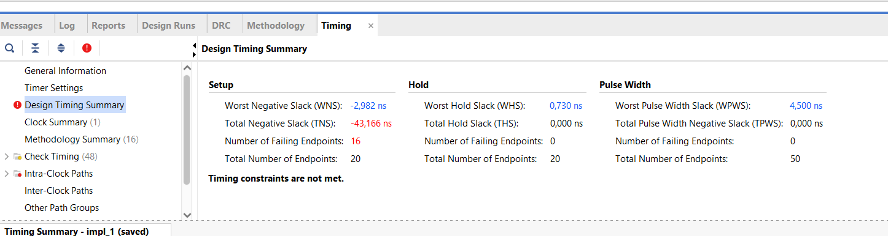
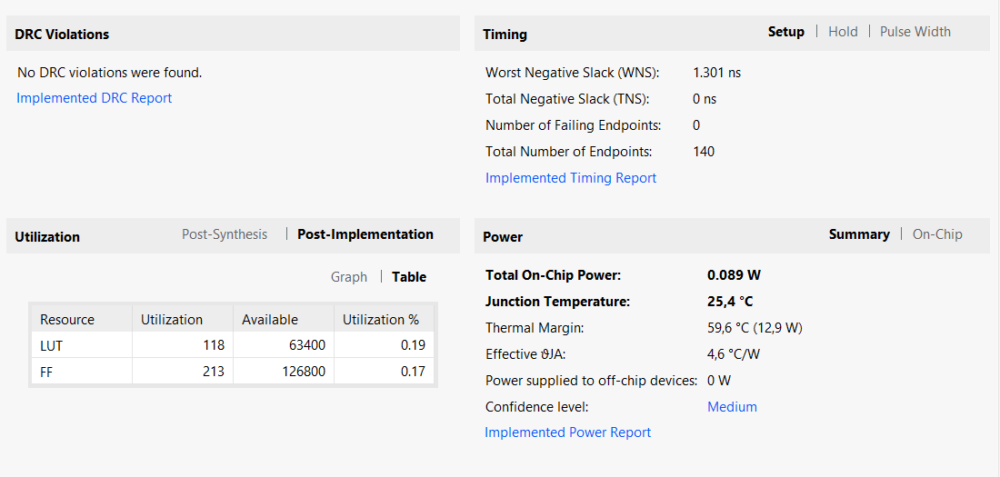
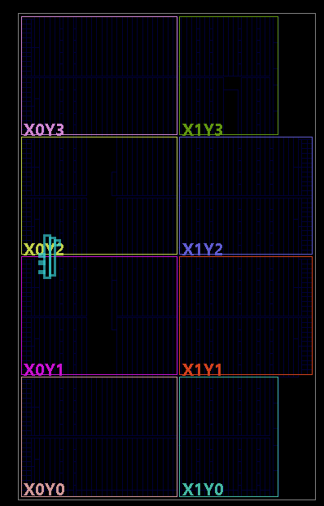

# vivado — simulate and synthesise in Vivado

Everything Vivado needs is in this folder, apart from the design itself, which
lives in `rtl/` so that Vivado and the Python test suite compile the very same
files.

```
vivado/
├── create_project.tcl        builds a ready-to-use Vivado project (start here)
├── synth/
│   ├── takum_mul_synth_wrapper.vhd   registers around the design, for timing
│   ├── nexys_a7.xdc                  clock constraint
│   ├── build.tcl                     batch synthesis: area, timing, power
│   └── results.md                    where the numbers go
└── sim/
    ├── tb_takum_mul_wave.vhd         waveform testbench, N = 8, self-checking
    ├── wave.tcl                      arranges the waveform window
    └── README.md                     how to run it and read the waveform
```

## The files Vivado needs

**For synthesis** (Design Sources), all set to **VHDL 2008**:

| # | File | What it is |
|---|---|---|
| 1 | `rtl/codec/predecoder.vhd` | official codec (patched), decoder core |
| 2 | `rtl/codec/decoder_logarithmic.vhd` | official codec, decoder |
| 3 | `rtl/codec/postencoder.vhd` | official codec (patched), encoder core and rounding |
| 4 | `rtl/codec/encoder_logarithmic.vhd` | official codec, encoder |
| 5 | `rtl/takum_mul_log.vhd` | the multiplier |
| 6 | `rtl/takum_mul_top.vhd` | the chain: decoder → multiplier → encoder |
| 7 | `vivado/synth/takum_mul_synth_wrapper.vhd` | **top module**: input and output registers |

**Constraints:** `vivado/synth/nexys_a7.xdc`.

**For simulation** (Simulation Sources): `vivado/sim/tb_takum_mul_wave.vhd`,
also VHDL 2008, set as the simulation top. It uses files 1 to 6.

Files 1 to 6 are the design. File 7 exists only to measure it: the design is
combinational, and without registers around it Vivado has no path to time.
If you want only the multiplier inside a larger design of your own, files 1 to
6 are all you need, with `takum_mul_top` as the entity to instantiate.

## Option A — let the script build the project (recommended)

1. Open Vivado. On the start screen: **Tools → Run Tcl Script…**
2. Pick `vivado/create_project.tcl`.

That creates `vivado/project/` with every file above added, all of them
already set to VHDL 2008, the wrapper as the synthesis top (N = 16, full
chain), the testbench as the simulation top, and the simulation set to run to
the end. The Tcl console ends with the exact command to arrange the waveform.

From there:

- **Simulation:** Flow Navigator → Run Simulation → Run Behavioral Simulation,
  then paste the `source …/wave.tcl` line the script printed. Everything about
  the waveform is in [`sim/README.md`](sim/README.md).
- **Synthesis:** Run Synthesis, then Run Implementation; open the reports
  (Report Utilization, Report Timing Summary). To change the width or the
  variant: **Settings → General → Generics/Parameters**, `N` and `USE_CHAIN`
  (1 = full chain, 0 = multiplier alone).

## Option B — by hand

1. **Create Project → RTL Project**, part `xc7a100tcsg324-1`
   (Nexys A7-100T; for the A7-50T, `xc7a50tcsg324-1`).
2. **Add Sources → Add or create design sources**: files 1 to 7.
3. **Add Sources → Add or create constraints**: `nexys_a7.xdc`.
4. **Add Sources → Add or create simulation sources**: `tb_takum_mul_wave.vhd`.
5. Select all the `.vhd` files in the Sources window → right click →
   **Set File Type… → VHDL 2008**. *Skipping this is the most common error:*
   the code uses VHDL-2008 constructs and will not compile as VHDL-93.
6. Right click `takum_mul_synth_wrapper` → **Set as Top**; in the Simulation
   Sources, right click `tb_takum_mul_wave` → **Set as Top**.
7. **Settings → Simulation → Simulation tab → `xsim.simulate.runtime`**: `all`
   (the default 1000 ns stops before the end of the testbench).
8. **Settings → Synthesis → More Options**: `-mode out_of_context`
   (why: see below).

## Measuring area and timing: `build.tcl`

`synth/build.tcl` runs the whole flow by itself, always with the same
settings, and prints the numbers at the end. Use it for every value that goes
into a table, so that all widths and both variants are measured the same way.

What it does, in order:

1. reads the six files from `rtl/`, the wrapper and `nexys_a7.xdc`;
2. synthesises out of context, with the width and variant you ask for;
3. sets the clock period (10 ns unless you say otherwise);
4. implements: `opt_design`, `place_design`, `phys_opt_design`, `route_design`;
5. writes the reports to `synth/reports/` (utilisation, timing, the 10 worst
   paths, power);
6. prints a summary and a row ready to paste into
   [`synth/results.md`](synth/results.md).

### Running it from the Vivado Tcl Console

In Vivado, in the **Tcl Console** at the bottom (use your own path, with `/`):

```
close_project
set argv {16 mul}
source C:/path/to/takum-multiplier-vhdl/vivado/synth/build.tcl
```

- `close_project` closes the open project, because the script works without
  one. Only needed once per session.
- `set argv {16 mul}` chooses the run: width (`8`, `16`, `32`, `64`), variant
  (`chain` = decoder + multiplier + encoder, `mul` = the multiplier alone),
  optionally the clock period in ns (`{16 mul 10.0}`) and `nodsp` to forbid
  DSP blocks (`{16 mul 10.0 nodsp}`).
- For the next run, change `argv` and repeat the `source` line (the up arrow
  brings it back).

All eight combinations in one go:

```
set script C:/path/to/takum-multiplier-vhdl/vivado/synth/build.tcl
foreach n {8 16 32 64} { foreach v {chain mul} { set argv [list $n $v]; source $script } }
```

From a terminal where `vivado` is on the path, the equivalent of one run is
`vivado -mode batch -source build.tcl -tclargs 16 mul`, run inside
`vivado/synth`.

The end of every run looks like this:

```
run          : chain_n16 on xc7a100tcsg324-1
period       : 10.0 ns
WNS          : -2.982 ns
path delay   : 12.982 ns   (period - WNS)
Fmax         : 77.0 MHz
Slice LUTs   : 258   (LUT cells: ...)
CARRY4       : 14
DSP blocks   : 0
...
row for results.md:
| 16 | 258 | 14 | 0 | 50 | 12.982 | 77.0 | 0.006 |
```

### How the numbers are measured

**One clock constraint for everything.** Every design, takum or posit, every
width, is constrained at the same 10 ns, and the maximum frequency is
estimated as **Fmax = 1000 / (10 − WNS)** MHz. A negative WNS is expected and
fine: it only means the design needs more than 10 ns, and by how much. Do not
loosen the period to make the warning go away. Vivado optimises only until it
meets the target it is given, so a looser target gives a slower result: the
full chain at N = 16 reached 12.98 ns with a 10 ns target, but 13.83 ns with a
13 ns target. What makes a comparison fair is the same rule for every design.

`build.tcl` reads `nexys_a7.xdc` before synthesis, so keep the period in that
file at 10 ns; the period you pass in `argv` applies from implementation on.

**Why out of context.** The wrapper has 6N + 22 ports. The Nexys A7 has 210
pins, so from N = 32 on the design does not fit the package, and even when it
fits, the input registers end up next to I/O pads scattered around the chip,
so the timing measures long wires instead of the multiplier. Out of context
there are no pins at all, and the clock is declared as coming from a global
buffer (`HD.CLK_SRC` in the XDC), so the reported path is register → design →
register, which is what is being compared.

**Widths worth measuring:** 8, 16, 32 and 64, both variants. The interesting
question is how the numbers grow with N: the codec paper argues that the takum
codec scales better than posit codecs because it only ever looks at the 12
most significant bits.

**DSP blocks.** The takum multiplier is an adder and should use none. A posit
multiplier contains a significand multiplier, which Vivado maps onto DSP
blocks; comparing LUTs alone would hide that cost. Report DSPs, and also run
both designs with `nodsp` for a like-for-like LUT comparison.

**Power.** Use the *dynamic* power. The total also includes about 84 mW of
static power, which is the leakage of the whole chip and the same for any
design. The value is Vivado's vectorless estimate: fine for comparing designs
measured the same way, not an absolute figure.

## Results

All eight runs (both variants at 8, 16, 32 and 64 bits) are in
[`synth/results.md`](synth/results.md), with an analysis and the critical path
of each run. In short: no DSP block anywhere; the multiplier alone takes 34 to
118 LUTs and meets 10 ns at every width (115 to 144 MHz); the full chain takes
168 to 880 LUTs, most of it the codec, and runs at 63 to 83 MHz because the
whole chain is one combinational path.

The pictures below come from those runs.

**Timing summary of the full chain at N = 16.** The worst path misses 10 ns by
2.982 ns, so it needs 12.98 ns, about **77 MHz**. All 16 failing endpoints are
the 16 output bits, and the ten slowest paths, each ending at a different bit,
all take between 12.7 and 13.0 ns: the delay comes from the depth of the chain,
not from one bad bit.



Its critical path crosses the whole chain in one clock cycle, 19 logic levels,
40 % of the delay in logic and 60 % in routing:

```
register a[9] → decoder (LUTs) → adder lbar_a + lbar_b (CARRY4)
   → saturation compare (fan-out 44) → encoder (LUTs)
   → rounding increment (CARRY4) → register y[14]
```

**Design summary of the multiplier alone at N = 64.** After the eight runs,
Vivado keeps the last design it implemented open, and that is the one this
summary shows: its numbers are exactly those of the `mul_n64` row in
`synth/results.md`. It meets the 10 ns constraint with 1.301 ns to spare (8.70 ns, about
115 MHz), with 118 LUTs; the 213 flip-flops are the measurement wrapper's
registers. *No DRC violations* confirms the configuration-voltage lines added
to the XDC.



**Where it sits on the chip**, same run: the multiplier alone at N = 64 takes
about 60 of the device's 15,850 slices, in a narrow column that follows the
carry chain of the adder.



The hierarchical utilisation report of a chain run lists all LUTs under `mul`.
That does not mean the multiplier alone takes them all: synthesis flattens the
hierarchy and merges decoder, multiplier and encoder to optimise them
together. The cost of the multiplier on its own is what the `mul` runs
measure.

## Common problems

| Symptom | Cause and fix |
|---|---|
| Syntax errors in `predecoder.vhd` or in the testbench | files not set to VHDL 2008 |
| `[Common 17-1293] The path '…/takum_mul.cache/wt' … is not writable` | Windows blocked the project folder. Close Vivado, delete `vivado/project/`, keep the repository in a short path without spaces outside synced folders (for example `C:\takum\`), and run `create_project.tcl` again |
| Generics/Parameters window says "No content" | no generics set, so the VHDL defaults apply: `N = 16`, `USE_CHAIN = 1`. Add `N` and `USE_CHAIN` there with **+** to change them |
| Critical warning `[Timing 38-282] The design failed to meet the timing requirements` | expected at 10 ns: see *How the numbers are measured*. Read the WNS and compute Fmax |
| Simulation stops at 1000 ns with no verdict | runtime not set to `all`; type `run all` |
| `cannot open file vec_mul_16.txt` | you added a testbench from `verification/tb/`; those read files and are meant for the Python flow. In Vivado use `sim/tb_takum_mul_wave.vhd` |
| Placement fails with "IO placement is infeasible" | synthesis was not out of context; see step 8 of option B |
| `NUMERIC_STD ... metavalue detected` at 0 ns | normal: internal signals are `U` until the first input arrives |

Do not run *Generate Bitstream*: out of context there are no pins, so there is
no bitstream to make, and it is not needed for the measurements.
