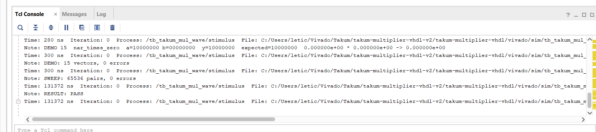
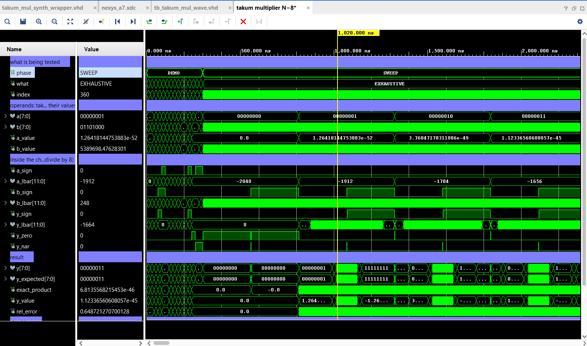

# vivado/sim — waveform testbench, N = 8

A self-checking testbench for the whole multiplier
(takum → decoder → multiplier → encoder → takum) at 8 bits, made to be opened
in Vivado and read as a waveform. It needs no input files: the test cases are
written in the testbench and the expected results come from a reference model
inside it.

| File | What it is |
|---|---|
| `tb_takum_mul_wave.vhd` | the testbench (simulation only, never synthesised) |
| `wave.tcl` | arranges the waveform window in Vivado: groups, radix, internal signals |

The screenshots on this page are in `docs/images/`.

## Running it in Vivado

1. **If you created the project with `vivado/create_project.tcl`, the
   testbench is already in it: skip to step 2.** You can check in the Sources
   window: under **Simulation Sources → sim_1**, `tb_takum_mul_wave` appears
   in bold (bold = top). For a project made by hand, add the six design files
   from `rtl/` and this testbench, all set to **VHDL 2008**, with
   `tb_takum_mul_wave` as the simulation top.
2. **Flow Navigator → Simulation → Run Simulation → Run Behavioral Simulation.**
3. In the Tcl console at the bottom, type the line that `create_project.tcl`
   printed, which looks like

   ```
   source C:/.../takum-multiplier-vhdl/vivado/sim/wave.tcl
   ```

4. Wait for the run to end (a few seconds; 131 µs of simulated time). The Tcl
   console ends with:

   ```
   DEMO: 15 vectors, 0 errors
   SWEEP: 65536 pairs, 0 errors
   RESULT: PASS
   ```

   

5. The waveform shows the whole run. To read the demo cases, press **Go to
   Time 0** (|◀ in the toolbar) and drag from left to right over the first
   300 ns; the demo phase (`DEMO`) is followed by the sweep (`SWEEP`):

   

6. Optional: press **Ctrl+S** to save the arrangement of the waveform window
   as a `.wcfg` file, so next time it opens without running `wave.tcl`.

Without `wave.tcl` the testbench still works: Vivado shows the testbench's own
signals, which are enough to follow everything except the internal `lbar`
values. Make sure the simulation runs to the end: the project script sets the
run time to `all`, but a project made by hand stops at 1000 ns by default —
type `run all` in the Tcl console, or set
**Settings → Simulation → Simulation → xsim.simulate.runtime** to `all`.

A few `NUMERIC_STD ... metavalue detected` warnings at 0 ns are normal: before
the first input arrives, the internal signals of the codec are still `U`.

## What happens in the run

Two phases, shown by the signal `phase`:

- **DEMO** (0 – 300 ns): 15 hand-picked cases, 20 ns each, named by the signal
  `what`. Their expected results were computed with
  `verification/takum_model.py`.
- **SWEEP** (300 ns – 131 µs): all 2^8 × 2^8 = 65,536 pairs, 2 ns each, checked
  against the reference model in the testbench.

In each period the inputs change, the testbench waits half a period for the
chain to settle, compares `y` with `y_expected`, and holds the inputs for the
other half so the result stays on screen.

## Reading the waveform

The 15 demo cases, 0 to 300 ns, with the cursor on case 7, `ROUNDED`:


At the cursor, `a_lbar` = 1 and `b_lbar` = 36, that is 0.125 and 4.5 (divide
by 8), and `y_lbar` = 37, the exact sum 4.625 that goes into the encoder. At
that magnitude an 8-bit takum keeps only one fractional bit, so the encoder
rounds to 4.5: the exact product 10.10 becomes 9.49 (`rel_error` = −0.06), and
`y` equals `y_expected`. In the next case, `TIE_TO_EVEN`, `y_lbar` = 30 is 3.75,
exactly halfway between 3.5 and 4, and the encoder picks the even word, 4
(7.389). `match` stays at 1 and `errors` at 0 throughout.

The signals, in the order `wave.tcl` arranges them:

| Signal | Meaning |
|---|---|
| `what` | name of the current demo case |
| `a`, `b` | the operands, as 8-bit takum words |
| `a_value`, `b_value` | the same words as real numbers |
| `dut/a_lbar`, `dut/b_lbar` | what the decoders hand to the multiplier: the *barred* logarithm `lbar = (-1)^S · l` |
| `dut/y_lbar` | what the multiplier hands to the encoder: the sum, **before rounding** |
| `y` | the result word from the encoder |
| `y_expected` | what `y` should be |
| `exact_product` | `a_value × b_value`, before any rounding |
| `y_value` | `y` as a real number |
| `rel_error` | `(y_value - exact_product) / exact_product` |
| `match`, `errors` | `1` while `y = y_expected`; running count of mismatches |

Zero and NaR show as `0.0` in the real-valued signals; the bit patterns
(`00000000` and `10000000`) tell them apart.

In Vivado the `lbar` signals appear as signed integers: at N = 8 they have
3 fractional bits, so divide by 8 (12 is 1.5). To see the real value directly,
right-click the signal → **Radix → Real Settings… → Fixed Point**, binary
point 3, signed.

An example from the sweep: at a = `01110111` (6.9·10²⁵) and b = `01100110`
(729,416), `a_lbar` = 952 and `b_lbar` = 216, that is 119 and 27, and
`y_lbar` = 1168, that is 146 = 119 + 27, the exact sum. The encoder rounds it to
the nearest available word, 143, because at that magnitude an 8-bit takum
only has words every 16 steps of `lbar`. `y` equals `y_expected`, so the
hardware is right; `rel_error` = −0.78 is the precision of an 8-bit takum
that far from 1, not a fault.

### What each demo case shows

| # | Case | Takeaway |
|---|---|---|
| 1 | `1 × 1` | 1 has `lbar = 0`; 0 + 0 = 0 |
| 2 | `times one` | multiplying by 1 adds 0 to the logarithm: nothing changes |
| 3 | `pos × pos` | 2.117 × 2.117: `lbar` 1.5 + 1.5 = 3, which is representable, so the result is exact |
| 4 | `pos × neg` | 0.472 × −2.117 = −1: the sign is `a_sign xor b_sign`; note that the negative operand has `lbar = −1.5` although its magnitude is above 1, because `lbar` carries the sign (the "barred" value) |
| 5 | `neg × neg` | two negatives give a positive |
| 6 | `inverses` | 2.117 × 0.472 = 1: the logarithms cancel, `lbar` 1.5 + (−1.5) = 0 |
| 7 | `rounded` | 1.064 × 9.488 = 10.10, but `y_lbar` = 4.625 needs 3 fractional bits and at that magnitude an 8-bit takum keeps only 1, so it rounds to 4.5 = 9.488 |
| 8 | `tie → even` | 2.117 × 3.080: `y_lbar` = 3.75, exactly between 3.5 and 4; the encoder picks the word whose last bit is 0, which is 4 (7.389) |
| 9 | `saturate high` | the largest number squared stays the largest number: takum saturates, it has no infinity |
| 10 | `saturate low` | the smallest positive number squared stays the smallest: a nonzero product never becomes 0 |
| 11 | `max × min` | 7.9·10^51 × 1.26·10^−52 = 1: the format is symmetric around 1 |
| 12 | `saturate neg` | same as 9 with a negative sign |
| 13 | `0 × x` | zero times a number is zero |
| 14 | `NaR × x` | NaR (not a real) propagates |
| 15 | `NaR × 0` | NaR wins over zero |

## How the reference model works

The testbench checks the sweep against its own model, written from the
definition of the format rather than from the hardware:

1. Decode each word into its logarithm `l`, using the format definition
   (direction bit, regime, characteristic, mantissa), in integer units of 2^−7
   so every value is exact. An 8-bit takum reads like a 12-bit one ending in
   four zeros ("ghost bits"), hence 7 fractional bits at most.
2. Multiply: `l_y = l_a + l_b`, sign `S_a xor S_b`.
3. Pick the word of that sign whose value is nearest in the log domain; on a
   tie, the one with an even bit pattern. Zero and NaR are never candidates,
   which is why products saturate instead of overflowing or vanishing.

It deliberately does not use the crossed-sign rule that the hardware uses
(`lbar_y = (-1)^S_b · lbar_a + (-1)^S_a · lbar_b`), so a mistake in that
derivation would show up as mismatches. That was tested: with the signs not
crossed in the multiplier, the sweep reports 32,004 errors out of 65,536 pairs,
the same count the Python check in `verification/` finds for that broken
version.

## Running it without Vivado

From `verification/`:

```
python3 run_tests.py wave
```

runs the same testbench in GHDL and writes `verification/build/wave_n8.ghw`,
which GTKWave opens (`gtkwave build/wave_n8.ghw`). See
[`verification/README.md`](../../verification/README.md).
